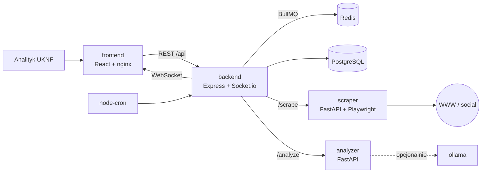

# Architektura



## Przepływ zadania

1. Wejście: URL (ręcznie lub z harmonogramu), import HTML/tekstu albo próbka demo. Backend zapisuje `scan_jobs` i dodaje zadanie do kolejki BullMQ (3 próby, backoff wykładniczy).
2. Scraper waliduje URL (każde przekierowanie i każde żądanie przeglądarki przechodzi blokadę SSRF), renderuje stronę w Chromium w trzech viewportach i zwraca jednolity JSON: treść, metadane (tytuł, autor, data, platforma, profil), linki, bloki tekstu ze stylami (rozmiar czcionki, kontrast, pozycja, widoczność, przesłonięcie, stopka/przypis, zwinięcie, ucięcie) i zrzut ekranu.
3. Deduplikacja: `(url, content_hash)` przed analizą, a po analizie odcisk simhash (odległość Hamminga w PostgreSQL) potwierdzany podobieństwem treści (`pg_trgm`). Duplikat nie jest zapisywany – jego adres trafia do lokalizacji oryginału.
4. Analyzer: podział na zdania, klasyfikator zdań (TF-IDF + regresja logistyczna), embeddingi LSA (TruncatedSVD), Moduły 1–3, scoring noisy-OR, agregacja do jednego obiektu.
5. Backend w jednej transakcji zapisuje materiał, analizę, przesłanki, podmioty i rekordy rejestru. Gdy wynik przekracza próg, tworzy alert. Socket.io wysyła `material:new` i `alert:new`.
6. Podsumowanie (Ollama lub szablon) zapisuje się asynchronicznie, więc nie blokuje wyników.

## Kontrakt danych

Wszystkie moduły korzystają z jednego schematu wyniku:

```json
{
  "score": 96.7,
  "module_scores": {"m1": 17.5, "m2": 96.7, "m3": 0},
  "modules": ["m2"],
  "findings": [{"module": "m2", "rule_id": "4", "title": "Rozmiar czcionki ryzyka", "status": "fail",
                "severity": 40, "legal_basis": "art. 44 ust. 2 lit. c rozp. del. 2017/565",
                "explanation": "Czcionka ostrzeżenia 9px wobec przeważającej 16px…",
                "evidence": [{"text": "CFD są złożonymi instrumentami…", "where": "ostrzeżenie", "font_size": 9}]}],
  "m1": {"firms": [], "instruments": [], "publisher": {"type": "podmiot_trzeci", "name": "@konto", "platform": "tiktok"}},
  "m3": {"classification": "indywidualne_doradztwo", "entities": []},
  "ml": {"model": "tfidf-lr-…", "max": {"profit": 0.9, "risk": 0.1}}
}
```

Statusy przesłanek: `fail`, `warn`, `pass`, `na` (nie dotyczy), `not_checked` (brak danych, np. reguły wizualne dla tekstu).

## Scoring i próg

Wynik modułu to `100 · (1 − Π(1 − wᵢ))`, gdzie `wᵢ` to waga reguły przy statusie `fail` albo połowa wagi przy `warn`. Wynik materiału to maksimum z modułów. Próg z panelu kalibracji zmienia tylko decyzję (alert i kategoria ryzyka), a nie wynik klasyfikatora. Poziomy ryzyka w stałej skali: 0–30 niskie, 31–70 średnie, 71–100 wysokie.

## Wzbogacanie danych

| Źródło | Sposób | Dane | Uwagi |
|---|---|---|---|
| KRS (`api-krs.ms.gov.pl`) | na żądanie, bufor 6 h | nazwa, forma, KRS/NIP/REGON, rejestracja, kapitał, adres, WWW, zarząd, rada, prokurenci, wspólnicy | dane osób zanonimizowane w publicznym API |
| GLEIF (`api.gleif.org`) | na żądanie | LEI, nazwa prawna, kraj, status, forma | wyszukiwanie pełnotekstowe po nazwie |
| Lista ostrzeżeń publicznych KNF | snapshot (`tools/watchlists_import.py`) | nazwa, KRS/NIP/REGON, domeny, podstawa prawna, prokuratura, orzeczenia | dopasowanie: domena > KRS/NIP > nazwa |
| Rejestr MiCA ESMA (CASPS/NCASP) | snapshot | autoryzowani CASP (usługi, kraj, organ) i podmioty niezgodne | |

Backend wzbogaca nowe spółki w tle (kolejka szeregowa, 1 podmiot/2 s) i na żądanie (`POST /api/entities/:id/enrich`, opcjonalnie z numerem KRS). Wyniki: `registry_records` (historia odczytów), `persons`/`person_links`.

## Rozbudowa

- Nowa reguła: funkcja w `analyzer/app/rules_m2.py` i wpis w `CATALOG`. Trafia automatycznie do API, bazy i UI.
- Nowy rejestr: adapter w `analyzer/tools/` zapisujący snapshot oraz rekord w `registry_records`.
- Nowe źródło social: parser w `scraper/app/extract.py` (`platform_for`, `social_handle`).
- Skalowanie: worker BullMQ działa w backendzie (`WORKER_CONCURRENCY`). Scraper i analyzer są bezstanowe, więc można je replikować.
